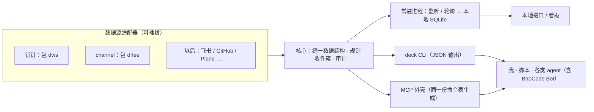

# deck 计划

> 状态：v0 已运行，v1 分步完善；近期实现与验证边界见 5.2～5.4。
> 更新：2026-11-11

## 1. 目标

做一个个人的、通用的「项目与消息中枢」：以**项目**为中心，把相关群聊、代码仓库、环境、任务和日志统一管起来；能看到群消息和自己的回复，能增删要监测的群，后续让 AI 辅助处理任务、修复小 bug。

- 不绑定某个应用：BaoCode、Claude Code、Codex、脚本都只是使用方。
- 不绑定某个数据源：钉钉、内部 channel 先接，以后能加飞书、GitHub、Plane 等。

## 2. 已定原则

| 事项 | 决定 |
|---|---|
| AI 难点（分级准确性、提示注入等） | 先占位，接口留好，后续慢慢优化 |
| 部署、操作服务器 | 起步每次都要我审核；稳定后逐步放权 |
| AI 对外回复 | 用机器人身份，带可配置的身份前缀（如「我是 X 助手」） |
| 数据保存 | 先存本地 |
| 试点 | MX 项目，我自己开测试群测 |
| 团队 | 支持；前期由我审阅 |
| 命名 | 项目与命令行都叫 `deck` |

## 3. 结构

- **核心 + 常驻进程**：管状态、监听、去重、规则、存储、审计。
- **CLI 为主入口**：人和 agent 都用；所有命令支持 `--json`。
- **MCP 为薄壳**：CLI 稳定后从同一份命令表生成，不单独写逻辑。
- **本地网页看板**：项目、群、时间线、审阅队列、日志。
- **技术栈（暂定）**：Python + uv；要分发给团队时再考虑 Go/Rust 单文件。

### 3.1 数据模型

- **项目**：名称、关联群/频道、代码仓库、环境（测试/生产）、负责人、任务后端、风险策略（AI 不许碰的目录/功能）。
- **会话**：来源、原始 id、所属项目、监测规则。
- **消息**：来源、原始 id、会话、发送人、时间、内容、回复关系、是否我发的。
- **事件**：新消息、@我、撤回、已读、任务变化、部署结果等。
- **任务**：标题、状态、来源消息链接、所属项目、外部任务 id（如已同步）。
- **操作日志**：谁（我 / AI）、做了什么、为什么、结果、关联对象。

所有对象都保留来源和原始 id，回复和同步时能原样找回。

### 3.2 适配器协议

每个数据源是一个独立可执行程序（如 `deck-adapter-dingtalk`），经标准输入输出交换 JSON，声明自己支持的能力：

| 能力 | 说明 |
|---|---|
| `conversations` | 列出会话 |
| `read --since <游标>` | 增量读消息 |
| `search` | 搜索消息 |
| `send --reply-to` | 发送 / 回复 |
| `listen` | 实时监听；不支持时核心退回轮询 |
| `tasks` | 任务的列出、创建、更新 |

- 适配器只包装现成 CLI，复用它们的登录和安全机制，不重写接口。
- 接新数据源 = 写新适配器，核心不改；语言不限。
- 锁定上游 CLI 版本，写契约测试防止输出格式变化后静默失效。

### 3.3 配置

一份 YAML：启用哪些数据源、每个项目关注哪些群（白名单）、规则（什么算重要、什么要建任务、推到哪）、任务后端、AI 回复的身份前缀。加群改配置即可。

### 3.4 安全底线

- 对外发送默认两步：先草稿，确认后才发。
- 所有发送和改动写审计日志，支持 `--dry-run`。
- 只有白名单内的会话允许发送。
- 部署只走已有 CI/CD；AI 不直接持有部署凭据。

## 4. 数据源

| | 钉钉 `dws`（官方开源） | 内部 channel `drlee` |
|---|---|---|
| 读 | 群历史、未读会话、@我、搜索、按发送人 | 频道、消息、线程、搜索、@我、未读、通知 |
| 实时 | `dws event +listen-im`（长连接，NDJSON） | CLI 无；后端有 SSE `/api/v1/channels/stream`，计划给 `drlee` 加 `watch` 子命令 |
| 发 | 用户身份 `send`；机器人 `send-by-bot` | `messages send --reply-to` |
| 任务 | `todo`、`calendar`、`aitable` | `commitments`、`digest`、`calendar` |
| 前提 | 企业管理员授权（共创阶段，有白名单） | `drlee auth login`；请求 Dev 环境前需方案批准 |
| 退路 | 企业内部应用机器人 + Stream：只收 @机器人 的消息 | — |

## 5. 功能与阶段

### 阶段 0：验证（1～2 天，不写 deck）

测试群：钉钉 `management-x-dev-TEST`（`cid4oG2GluqzmLDcLfoBv2OHQ==`）；channel `测试dev-1023`（`745d91a0-ec60-4b96-8bf8-680389a48a9c`）。
工具：`deck/tools/dws/dws` v1.0.67、`deck/tools/drlee/drlee` 0.0.7（均已核对官方哈希，未加入 PATH）。

- [x] `dws` 登录（企业授权已通过）、读群消息（`chat +chat-messages`）、实时监听（`event +listen-im --kind group --chat-id`，约 0.4 秒到达，我在客户端发的消息也会收到）
- [x] `dws` 发一条消息（`chat +send-to-group --yes`，以本人身份 + AI 角标，2026-11-09 已发并回读确认；群里已有 MX 机器人 `management-x-dev`，可评估改用它的身份发）
- [x] `drlee` 登录（正式地址）、读频道消息（`--json channel messages list`，按 `message_sequence` 增量，可用 `--after-sequence` 轮询）
- [x] `drlee` 回复一条（`channel messages send --reply-to`，进入原消息的线程；返回结果不含新消息 id，需回读确认）
- [x] 两个 CLI 输出都是结构化 JSON，够做统一数据结构；注意时间格式不同（channel 是 UTC ISO，钉钉是本地时间字符串 + 毫秒时间戳）

### v0：知道发生了什么

骨架已搭（2026-11-09）：`uv run deck <命令>`，数据在 `~/.deck`（目录 0700，`config.toml`、`deck.db` 0600）。命令：`init`、`project add/list`、`group add/list/remove`、`sync`、`timeline [--mine]`、`send`（不加 `--yes` 只预览，`--ai` 加身份前缀，发后自动回读）、`log`、`prune`；全局 `--json`。配置改用 TOML（Python 自带解析，无第三方依赖）。

- [x] 项目登记：MX 及其关联群、仓库
- [x] 群管理：增删监测的群
- [x] 群提醒规则：全部关注 / 仅 @我或回复我 / 关键词；免打扰按服务所在电脑时区，支持跨午夜和全天。只影响提醒与待处理状态，不限制完整消息采集，不自动标记已处理，便于后续 AI 查看和起草、由用户最终审核
- [ ] 汇总频率（接入 AI 汇总时再做）
- [x] 两个适配器（钉钉、channel）+ 增量同步（按游标续读、按消息 id 去重、一个群失败不影响其他群）
- [x] 常驻监听：`deck serve`（含看板）或 `deck watch`；钉钉每群一个 `dws event +listen-im`，来消息即增量同步，断线指数退避重连（30 秒起、最长 10 分钟），断开期间退回轮询，另每 5 分钟补拉；channel 每 `poll_seconds` 轮询；SIGTERM/SIGINT 时让 dws 正常退订
- [x] 消息时间线：按项目 / 群看消息，标出我的回复
- [x] 待我回复：@我、之后我在该群没再说话的消息；机器人消息（平台标记）不算，认不出的通知机器人所在群设为「不提醒」；超过推送级别「高」的等待时间标超时（`deck awaiting`、看板）
- [x] 操作日志（项目、群、发送、清理都记录）
- [x] 保存期限：`deck prune` 删除超过 `retention_days` 的消息（目前手动运行）；挂在任务上的消息作为证据保留，任务删除后才会被清理
- [x] 本地看板骨架（`web/`，React 19 + Vite + Tailwind 4；`deck serve` 提供，只监听 127.0.0.1，校验 Host，写请求需 `X-Deck` 头）：概览、时间线（打开即到最新、连续消息合并、加载更早）、待我回复、群管理（加群 / 新建项目 / 移除）、操作日志、两步确认发送；支持深色和手机宽度
- [ ] 开机自启（launchd）
- [x] 远程访问（2026-11-10）：所有接口需登录；一次性登录码（10 位、10 分钟、用一次，库里只存哈希）换 30 天滚动会话（HttpOnly + SameSite=Strict，HTTPS 下加 Secure）；同一来源 10 分钟失败 10 次即 429；`deck access link/list/revoke`、设置 → 访问（设备列表、二维码添加设备）；`[server]` 配置 host / port / public_urls / allowed_hosts / trust_proxy / tls_cert / tls_key；Host 白名单（本机、本机网卡 IP、中继域名）；可挂在中继子路径下；PWA manifest。设备可禁用 / 启用（保留登录，不用重新配对）或移除；不能禁用正在用的设备。2026-11-10 起本机配置 `host = "0.0.0.0"`，局域网和 Tailscale（100.112.181.122）均可访问。局域网 HTTP 是明文，推荐 Tailscale 或 HTTPS 中继

### v1：辅助处理

- [ ] 从消息提取任务，链接回原消息；状态变化回群里说明
- [ ] 重复反馈合并
- [ ] 每日 / 每周项目汇总
- [ ] 回复草稿 + 审阅队列（草稿、待合并改动、待部署版本集中一处）
- [ ] AI 回复统一带身份前缀
- [ ] 发版后自动生成更新说明发到相关群
- [ ] 费用看板（按项目 / 任务统计 token）

### v2：自动修复

Bug 分级（级别不能只听 AI 自评，改完后用客观条件复核，不满足就降级）：

| 级别 | 范围 | AI 做到哪 | 我做什么 |
|---|---|---|---|
| L0 自动 | 文案、样式、配置等小改；改动少于 N 行；不碰禁区；有测试覆盖 | 修复 → 测试 → PR → 合并 → 部署测试环境 → 冒烟 → 机器人回群 | 上生产前批准 |
| L1 AI 修、我审 | 改了逻辑，或 L0 检查没过 | 修复 → 测试 → PR 进审阅队列 | 看改动，批准或打回 |
| L2 只分析 | 原因不清或要改多处 | 原因、复现步骤、方案 | 决定怎么改 |
| L3 不碰 | 权限、支付、数据迁移、安全、生产配置 | 只建任务并通知 | 自己处理 |

- [ ] 先开 L2、L1；部署一律等我审核
- [ ] 稳定后开 L0，并逐步放开部署权限

### 接入 BaoCode

- [ ] 写 `deck` 技能，让 BaoCode Bot 用 CLI 查看、起草、建任务
- [ ] Bot 在项目里启动 agent 修 bug，改动在 YCode 改动页审阅（不改 link）
- [ ] 需要实时唤醒 Bot 时，在 BaoCode `mobile-link` 加本地事件入口
- [ ] 需要手机专用看板时，再加可选的 link 扩展（官方版下自动隐藏）

## 5.1 历史界面结构方案（2026-11-09；部分入口已调整，以当前界面为准；任务、AI 设置和连接信息已接后端，修复部署仍为占位）

侧栏平铺 5 个入口：收件箱、消息、任务、项目、设置（连接 / AI / 日志）。项目是各视图通用的筛选维度，不是入口门槛。

- 收件箱：所有等我处理的（待我回复、AI 草稿、AI 修复、待部署），列表 + 右侧详情
- 消息：聊天软件式，左群列表（最近活跃、未读、按项目 / 来源筛选，可「未归类」），右聊天
- 任务：看板（待处理 / 进行中 / 待审阅 / 已完成），可从消息一键转任务
- 项目：列表 → 主页（概览、任务、消息、修复与部署、设置）
- 设置：连接（平台卡片、登录剩余时间、健康）、AI（模型、身份、自动化规则、预算、总开关）、日志
- 全局：搜索、AI 总开关、「问 AI」面板（可查 deck 数据做总结）
- 视觉约定：测试群灰「测试」、正式群橙「正式」；AI 产出紫色「AI」；发正式群、部署用红色二次确认
- 手机：底部标签 收件箱 / 消息 / 任务 / 设置，详情整页推入

补充事项：AI 总开关、测试 / 正式群标记、连接健康与登录过期提醒（这轮做）；跨平台人员、通知推送、搜索问答、项目知识库、消息→任务→修复→部署闭环、日报工时联动、多用户（后续）。deck 跑在本机，睡眠时不监听，代码保持可迁到常开机器。

### 5.2 后端对齐（2026-11-10，顺序 6 → 2 → 3 → 4）

- 消息与提醒设置由网页 / `deck config show/set` 共用：基础值来自 `config.toml`，网页或 CLI 修改的覆盖值保存在同一个 SQLite 的 `settings.runtime_config`。不覆盖 TOML、工具路径或服务安全配置；CLI 下次执行、网页下次请求读取有效值。网页只提交本次编辑的字段，避免覆盖其他设备的修改。保存期限只在手动 `deck prune` 时清理，不用于隐藏仍存库的未处理 @我消息。
- 群提醒规则只改变状态，完整消息仍同步；已读是 deck 本地已读，已处理和任务完成相互独立。当前仍使用聊天窗口，不新建 AI 审批系统。
- 连接健康读取本地 CLI 账号摘要和版本，缓存 60 秒，不联网验证登录，不保存或返回凭据；未提供到期时间时显示未知，访问凭据可能刷新，到期不等于整个登录失效。
- 发送草稿 10 分钟有效，确认绑定内容、群和设备。API 确认需使用预览返回的 `operation_id`；CLI 可用 `deck send <群> --operation <编号> --yes`。相同编号重试不会再次调用平台；未知结果不自动重发。平台接受与回读状态分别返回。
- 项目允许编辑名称和仓库，简称不变；群可调整归属，历史消息、规则及任务来源保留，已有任务仍属于原项目。不实现项目删除或自动批量移动任务。
- 搜索排在上述功能之后：本轮仅预留独立查询、游标分页、消息定位的类型契约，仍只检索最近 200 条并明确提示限制；不提供假成功的空搜索接口。

### 5.3 单一入口与切网恢复（2026-11-10）

- 手机同 Wi-Fi 时不要求开启 Tailscale；离开局域网后通过 Tailscale 访问同一地址，不更换 origin、不重新配对。手机既不在局域网也未开 Tailscale 时不可达，这个边界已确认。
- 统一入口须显式固定，保存到本地 `settings.access_entry`，网页和 CLI 共用；不再根据网卡顺序或手机在线状态自动替换。电脑 IP 变化时显示不可用，不偷偷推荐新地址冒充同一入口。
- 当前采用固定 LAN 地址 + Tailscale 单主机 `/32` 子网路由。它要求电脑 LAN IP 保留不变；若电脑也换到别的局域网，不能保证此地址仍能本地直连，需要另行处理网络侧固定入口，不能靠页面重连解决。
- `deck access setup <URL>` 只预览，`--yes` 也只保存入口，不执行网络命令。路由方案保留已有宣告并提供恢复命令；读取已有路由失败时禁止生成覆盖命令。路由宣告、管理员批准、ACL 和真实服务重启都须单独确认后执行。
- `/32` 是单主机范围，不是端口白名单；须检查 tailnet 规则，只开放所需端口。HTTP 局域网连接仍是明文，不能标为已加密。
- auth/version 的只读探测 8 秒超时、单请求轮询；首次不可达及切网后自动重试，online / 前台恢复会唤醒。同版本恢复也刷新数据，断网不卸载聊天窗口，不清除未发送内容；写请求绝不自动重放。
- 应用侧已经用隔离模拟服务验证首次故障自动恢复、离线后恢复登录和聊天草稿；真实 Wi-Fi / Tailscale 切换仍须在路由批准后用手机验证，不能将代码完成视为网络已打通。
- 用户确认后，已固定 `http://10.49.36.140:8765/`、宣告 `10.49.36.140/32` 并正常重启真实 deck；本机和 LAN 页面均返回 200，原有两个群监听恢复、无同步错误。后续已检测到该 `/32` 路由批准并生效；当前浏览器未登录 Tailscale 管理后台，ACL 尚未核验，用户随后已确认手机远程访问正常。

### 5.4 AI、附件、搜索及手机设置修正（2026-11-11）

- 手机设置卡片收缩、长字段换行，长 CLI 版本只展示简版并提供可展开详情；已在隔离看板 320px、390px 宽度验证，开关不再被挤出屏幕。
- 模型采用可配置 OpenAI Chat Completions 兼容接口，默认关闭，地址和模型留空，不绑定供应商。密钥存在 macOS 钥匙串（默认条目 `deck-ai`），deck 只记条目名，不保存在网页或接口返回中（2026-11-13 由环境变量改为钥匙串：launchd 常驻服务读不到终端里的环境变量）；新的地址 + 密钥引用须在电脑执行 `deck ai configure '{}' --approve-endpoint` 明确批准，远程设备不能自行把本机密钥转发到新地址。不会在配置保存或服务启动时自动调用模型。
- 问答每次独立提问，不默认附带历史问答或本地数据。明确选项目或群后，提供最多最近 100 条消息和 50 条任务，标明范围和截取情况；群范围不会附带其他群任务，撤回消息不进入模型上下文。超出请求上限报错，不静默截断。模型只返回文字和已核对的引用，没有写工具；起草只填入聊天输入框，仍须预览确认才发。
- 提供全局月 token 预算、调用用量及并发预留；明确 HTTP 拒绝释放预留，网络超时或结果未知则保守保留，展示预留不是实际消费。按项目费用、自动修复、自动部署和自动群回复仍未启用。
- 附件仅先暂存本机，绑定设备会话和群，最多一个、10 MiB；后端校验类型与文件头，路径 UUID 化、文件 0600、目录 0700。确认操作 ID 才调用平台 CLI，同一操作重试不再次发送。channel 支持附件引用；钉钉附件引用明确拒绝，文字 + 普通文件会在预览说明分两条发送，部分失败不自动重发。保留文件原名，图片说明不展开用户文本中的额外本地图片路径。
- 上传记录暂不自动删除或过期。原生文件选择器的自动化受浏览器扩展本地文件权限限制；已使用页面内存生成附件验证本地上传、预览、确认和模拟发送，未向真实平台上传文件或发消息。
- 全量搜索覆盖本地全部已同步消息正文，不再限制最近 200 条；游标绑定查询范围并支持分页，结果可载入原消息附近上下文并高亮。当前不检索附件内部内容，也不承诺未同步到本地的平台历史。网页和 CLI 共用搜索及 AI 核心。
- 本轮使用隔离目录构建和模拟模型联调，不调用付费模型。经用户确认，已发布构建并正常重启真实 deck；本机和固定 LAN 入口的新页面、脚本与认证端点均返回 200，原有两个群监听恢复、无同步错误，AI 保持关闭。真实模型调用及真实群附件发送仍未测试，未发送测试消息。

## 6. AI 相关占位（后续优化）

- 群消息当数据不当指令（防提示注入）；修代码的 agent 隔离运行、拿不到密钥
- 只有白名单内的报告人能进入自动修复
- 反馈模糊时先要求复现，复现不了按 L2 处理
- 每个项目设 token 预算上限

## 7. 待定事项

1. ~~钉钉管理员能否给 `dws` 授权~~：已通过（2026-11-09 登录并读取、监听成功）
2. MX 项目：即 Management-X，仓库 `/Users/dip/Desktop/project/dip/dip-pm`（远端 codeup `BJ-ALG/dip-pm`，有 `docker-compose.yml`、`docker-compose.test.yml`）；测试群见阶段 0。测试先在本地跑（docker-compose），CI/CD 到 v2 再定
3. ~~主任务库~~：存 deck 本地；以后再按需同步 channel 事项 / 钉钉待办
4. ~~本地数据保存期限与加密~~：先保存一个月，可配置；加密从简——数据库文件仅本人可读（0600），deck 不保存任何凭据（登录态由 dws / drlee 自己管），依赖 macOS FileVault 全盘加密

## 8. 风险

- 范围膨胀：第一版只做两个数据源 + 「收件箱、回复、建任务」
- 上游 CLI 输出变化：锁版本 + 契约测试
- 合规：只用官方 CLI / OpenAPI，只订阅白名单群，不模拟客户端
- 测试覆盖不足会让 L0 变成赌博：测试越全的项目越早放权
